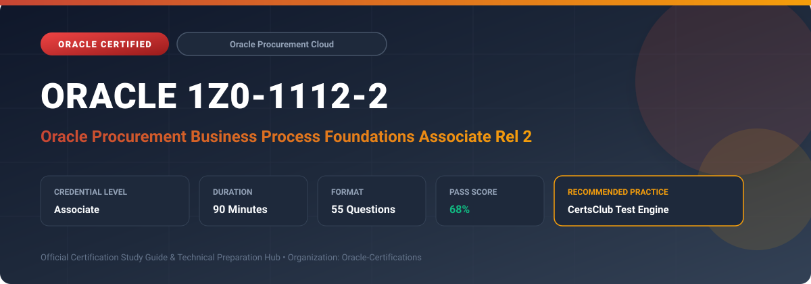

  

# Oracle 1Z0-1112-2: Oracle Procurement Business Process Foundations Associate Rel 2

---

## 1. Exam Overview & Candidate Profile

The **Oracle 1Z0-1112-2: Oracle Procurement Business Process Foundations Associate Rel 2** credential validates foundational understanding of corporate procurement business flows and supplier relationships.

Candidates validate competencies in requisitioning, purchasing, supplier qualification, strategic sourcing events, contract lifecycle management, supplier portal interactions, and procurement analytics.

### Target Audience & Prerequisites
- **Target Roles**: Implementation Specialists, Cloud Architects, Technical Leads, Enterprise Consultants, and Systems Engineers.
- **Recommended Experience**: 1–2 years of practical, hands-on experience designing, implementing, and maintaining corresponding Oracle solutions.
- **Credential Earned**: Associate Certification.

---

## 2. Key Exam Specifications

| Specification | Details |
| :--- | :--- |
| **Exam Code** | **Oracle 1Z0-1112-2** |
| **Official Title** | Oracle Procurement Business Process Foundations Associate Rel 2 |
| **Certification Track** | Oracle Procurement Cloud |
| **Exam Duration** | 90 Minutes |
| **Number of Questions** | 55 Questions |
| **Passing Score** | 68% |
| **Question Format** | Multiple Choice (Single/Multiple Answer), Scenario-Based Questions |
| **Delivery Provider** | Oracle University / Pearson VUE (Online Proctored or Test Center) |
| **Recommended Practice Engine** | [CertsClub Oracle Practice Tests](https://www.certsclub.com/oracle/1z0-1112-2-dumps.html) |

---

## 3. Official Blueprint & Exam Domain Breakdown

The examination assesses candidate competencies across core functional domains weighted as follows:

| Domain Area | Weighting |
| :--- | :--- |
| **Requisitioning & Self-Service Procurement** | `25%` |
| **Purchasing & Purchase Order Administration** | `25%` |
| **Supplier Management & Supplier Qualification** | `20%` |
| **Sourcing Negotiations & RFQ/RFP Cycles** | `15%` |
| **Procurement Contracts & Spend Compliance** | `15%` |

---

## 4. Deep Dive into Complex & Challenging Technical Topics

To secure a passing score on the 1Z0-1112-2 exam, candidates must master the following advanced concepts:

- Self-Service Procurement catalog management: punchout catalogs, internal catalogs, and non-catalog requests.
- Purchase order creation: manual, automated from requisition lines, and blanket purchase agreements.
- Supplier qualification management: onboarding questionnaires, evaluations, and qualification statuses.
- Strategic sourcing: RFI, RFQ, and auction events, surrogate bidding, and award evaluation.
- Contract terms library, clauses, deviations, and approval workflows.

---

## 5. Scenario-Based Demo & Practice Questions

### Question 1
Which procurement feature allows corporate employees to seamlessly browse an approved external vendor's live online catalog, add items to a cart, and return those items back to an Oracle requisition?

A) Punchout Catalog
B) Internal Item Master
C) Blanket Purchase Agreement
D) Sourcing Auction

- **Correct Answer**: `A) Punchout Catalog`  
- **Technical Explanation**: Punchout catalogs connect buyers directly to a supplier's e-commerce marketplace via cXML/OAG protocols, transferring selected items back into the self-service requisition.

---

### Question 2
What procurement document formalizes a long-term agreement with a supplier for negotiated item pricing over time, against which specific purchase orders (releases) can be generated?

A) Blanket Purchase Agreement (BPA)
B) Standard Purchase Order
C) Request for Quote (RFQ)
D) Goods Receipt Note

- **Correct Answer**: `A) Blanket Purchase Agreement (BPA)`  
- **Technical Explanation**: A Blanket Purchase Agreement establishes agreed terms, conditions, and pricing over a period, allowing buyers to issue purchase orders against the agreement as demands arise.

---

## 6. Recommended Preparation Strategy & Practice Testing Engine

Achieving certification in **Oracle 1Z0-1112-2** requires balanced theoretical study and scenario-based simulation practice:

1. **Review Oracle Documentation**: Master architecture guides, implementation workbooks, and administration manuals on the Oracle Help Center.
2. **Hands-on Lab Practice**: Execute real-world configuration, policy setup, and troubleshooting tasks in your cloud tenancy or test instance.
3. **Simulated Exam Drills**: Practice answering timed, scenario-based multiple-choice questions to familiarize yourself with the question formats, traps, and timing constraints.

### Practice With CertsClub
For realistic practice questions, updated dumps, and mock testing environments:
- **Resource**: [CertsClub Oracle Practice Test Engine](https://www.certsclub.com/oracle/1z0-1112-2-dumps.html)
- **Special Discount**: Use coupon code **`club20`** during checkout for an instant **20% discount** on all practice exam bundles and testing engines.

---

## 7. Official Documentation & References

- [Oracle University Certification Registry](https://education.oracle.com/)
- [Oracle Help Center Documentation Portal](https://docs.oracle.com/)
- [Oracle Cloud Infrastructure & Applications Guides](https://docs.oracle.com/en/cloud/)
- [CertsClub Oracle Certification Exam Practice](https://www.certsclub.com/oracle/1z0-1112-2-dumps.html)

---

## 8. SEO & Discovery Keywords

`oracle 1z0-1112-2, oracle 1z0-1112-2 exam, oracle 1z0-1112-2 dumps, 1Z0-1112-2 practice questions, 1Z0-1112-2 study guide, oracle procurement business process foundations associate rel 2, certsclub 1z0-1112-2`